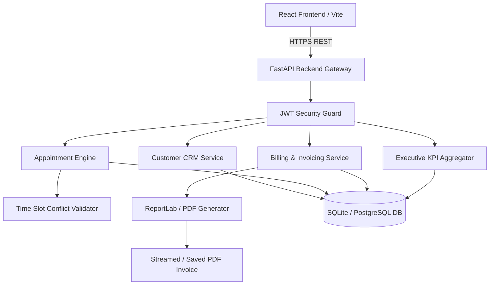
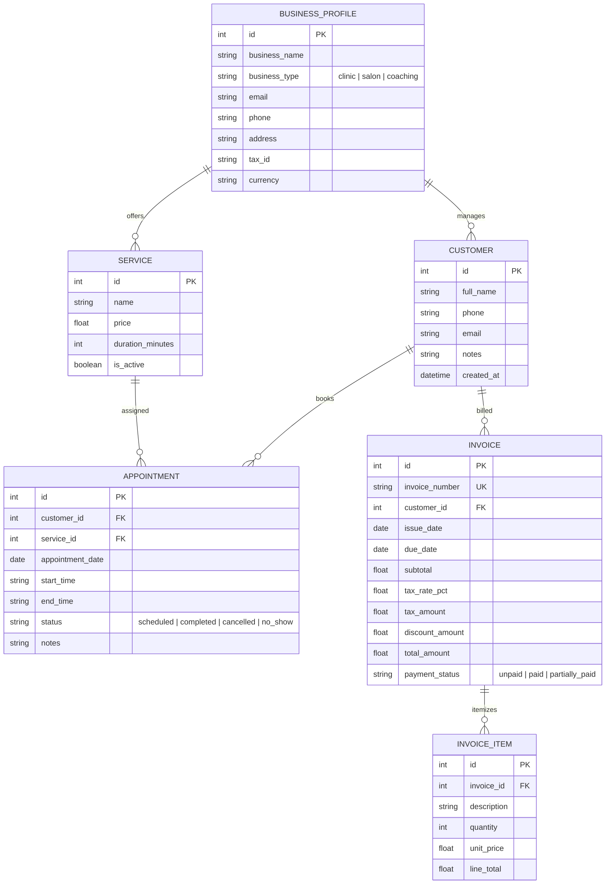

# Architecture Specification
## BizDesk: System Design & Technical Contracts

### 1. High-Level Architecture
BizDesk implements a robust, lightweight service-oriented monolith:
- **Presentation Layer**: React 18 SPA (Vite) + Tailwind CSS + Lucide Icons + Recharts.
- **API Application Tier**: FastAPI (Python 3.11) with clean separation across domain routers (`/auth`, `/business`, `/customers`, `/appointments`, `/invoices`, `/dashboard`).
- **PDF Generation Engine**: Python `reportlab` / `fpdf2` creating print-ready, vectorized PDF receipts.
- **Persistence Tier**: SQLite with foreign key enforcement and indexed queries, architected for direct PostgreSQL production deployment.

---

### 2. Database Schema (Entities & Relationships)

---

### 3. API Contract Specifications

| Method | Endpoint | Description | Request Body | Response (200 OK) | Error Codes |
|---|---|---|---|---|---|
| `POST` | `/api/v1/auth/login` | Authenticate owner & issue JWT | `{email, password}` | `{access_token, token_type, business_profile}` | 401 Unauthorized |
| `GET` | `/api/v1/customers` | List & search customer CRM | Query: `search, limit, offset` | `[{id, full_name, phone, email, total_visits}]` | 200 OK |
| `POST` | `/api/v1/appointments` | Book appointment with conflict check | `{customer_id, service_id, date, start_time}` | `{id, status, appointment_date, start_time}` | 409 Time Slot Conflict |
| `PATCH` | `/api/v1/appointments/{id}/status` | Update booking status | `{status: "completed"|"cancelled"}` | `{id, status, updated_at}` | 404 Not Found |
| `POST` | `/api/v1/invoices` | Create invoice & compute taxes | `{customer_id, items: [...], tax_rate, discount}` | `{invoice_id, invoice_number, total_amount}` | 422 Validation Error |
| `GET` | `/api/v1/invoices/{id}/pdf` | Stream generated PDF document | None | `application/pdf` binary stream | 404 Not Found |
| `GET` | `/api/v1/dashboard/metrics` | Executive revenue & booking KPIs | Query: `time_range="month"` | `{revenue, appointment_counts, top_services: [...], reminders: [...]}` | 401 Unauthorized |

---

### 4. Appointment Collision Prevention Algorithm
- Every booking request enforces a temporal non-overlap constraint:
  $$	ext{Slot } A 	ext{ overlaps Slot } B \iff (A_{start} < B_{end}) \land (A_{end} > B_{start})$$
- Evaluated within an atomic database transaction to prevent race conditions during concurrent bookings.
